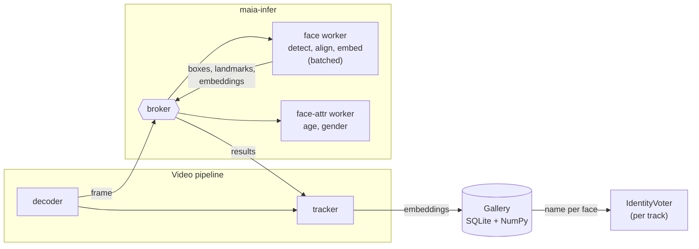

# maia-face

**Face detection, recognition, age/gender and an identity gallery for real-time video
analytics.** Runs in-process for scripts and enrollment, or as `face` / `face-attr` services
on [maia-infer](https://github.com/jemaia-elwrose/maia-infer) for live camera pipelines.



## What it does

- **Detect and recognise** faces with interchangeable backends, all aligned the same way
  (5-point similarity transform to the 112x112 ArcFace template), so detectors and
  recognisers can be mixed.
- **Identity gallery** in SQLite: enroll, search, remove. Several processes can share
  one gallery file: each notices the others' writes and reloads only then. Embeddings from
  different models are never compared with each other.
- **Decide per track, not per frame.** `IdentityVoter` names a person only when matches agree
  across frames; `AttributeSmoother` gives a stable age (median) and gender (confidence-weighted
  vote).
- **Age and gender** from face *and* body with MiVOLO; `associate()` pairs face boxes with
  person boxes from your detector.
- **CLI** for enrollment and quick checks; **workers** that maia-infer discovers by name.

## Models and licenses

| Backend | Detector / recogniser | Weights license | Install |
|---|---|---|---|
| `opencv` (default) | YuNet / SFace, 128-d | MIT / Apache-2.0: **commercial use OK** | included |
| `insightface` | SCRFD / ArcFace, 512-d | **non-commercial research only** | `[insightface]` |
| `face-attr` | MiVOLO (face + body) | code Apache-2.0; **check your checkpoint** (v2 weights: CC BY-NC 4.0) | `[mivolo]` |

The default backend is pure OpenCV: no PyTorch, fast on CPU, and licensed for products.
InsightFace is more accurate on small, blurred or side-on faces; use it for research or
after getting a commercial license from InsightFace. Weights download on first use into
`~/.cache/maia-face` (or `$MAIA_FACE_HOME`).

Face data is biometric data. A gallery is personal data under GDPR and the UAE PDPL, among
others: enroll people only with a lawful basis (usually consent), and keep `gallery.db` out
of version control (the provided `.gitignore` does).

## Quick start

```bash
pip install "maia-face @ git+https://github.com/jemaia-elwrose/maia-face"

python examples/smoke_test.py me.jpg            # checks the real models with one photo
maia-face enroll "Alice" alice1.jpg alice2.jpg
maia-face identify group.jpg --save annotated.jpg
maia-face verify a.jpg b.jpg
maia-face list
```

As services, for live video:

```bash
maia-infer broker &
maia-infer worker face --max-batch 8              # or: --opt backend=insightface
python examples/video_identify.py --source rtsp://camera/stream --show
```

```python
import numpy as np
from maia_face import Gallery, IdentityVoter
from maia_face.client import FaceClient

faces = FaceClient("tcp://localhost:5555")
gallery, voter = Gallery("gallery.db"), IdentityVoter(min_votes=3)

for face, match in faces.identify(frame, gallery):  # match.name is None if unknown
    decision = voter.update(track_id_of(face), match.name, match.score, frame_no)
    print(decision.name, decision.confidence)
```

Age and gender, pairing faces with person boxes from a detector such as `maia-infer worker yolo`:

```python
from maia_face import associate

owners = associate(face_boxes, person_boxes)  # person index per face, or -1
attrs = faces.attributes(frame, face_box, person_boxes[owners[0]])
print(attrs.age, attrs.gender, attrs.gender_conf)
```

```bash
pip install "maia-face[mivolo] @ git+https://github.com/jemaia-elwrose/maia-face"
maia-face setup-mivolo                    # fetches MiVOLO's source at a pinned commit
maia-infer worker face-attr --opt checkpoint=/models/mivolo_checkpoint.pth.tar
```

Why `setup-mivolo` instead of `pip install mivolo`: MiVOLO's package can't be built with current
tooling (its `setup.py` imports `pkg_resources`) and pins ultralytics 8.1.0, which would downgrade
other workers. Its model code only needs `timm==0.8.13.dev0` (later timm versions changed the
VOLO internals it builds on), which the `[mivolo]` extra pins. Run it in its own environment or
the provided image (`docker compose --profile attributes up`). Missing crops are passed as empty
inputs, as in MiVOLO's own pipeline; face-only checkpoints require a face crop.

With Docker (CPU, default backend):

```bash
docker compose up --build
docker compose run --rm cli enroll "Alice" /data/alice1.jpg      # ./data is mounted at /data
```

## Wire format

`face` replies with `arrays = [faces (N, 15), embeddings (N, D)]`, both float32. Each face row
is `x1, y1, x2, y2, score` followed by five `(x, y)` landmarks. `meta` carries `space` (which
model made the embeddings), `dim` and the recommended `threshold`. Send `meta={"embed": false}`
for detection only. All faces of a batch go through the recogniser in a single call.

## Choosing a threshold

Each backend ships with its recommended cosine threshold (SFace 0.363, ArcFace 0.35). Lower
means more matches and more false positives. For access control, raise it and require several
votes per track; for search ("show me every time Alice appeared"), lower it and review results.
`maia-face identify` prints the score of every face, so you can tune it on your own cameras.

## Project layout

```
src/maia_face/
  backends/      opencv (YuNet + SFace), insightface (SCRFD + ArcFace), mivolo
  align.py       5-point alignment to the ArcFace template
  gallery.py     SQLite identity store, multi-process safe, vectorised search
  tracking.py    IdentityVoter, AttributeSmoother
  association.py face <-> person matching, safe crops
  workers.py     maia-infer workers: face, face-attr
  client.py      FaceClient for pipelines
  weights.py     download-once weights with integrity checks
  cli.py         maia-face enroll | identify | verify | list | remove | setup-mivolo
examples/        smoke test, video identification, age and gender per person
```

## Development

```bash
pip install -e ".[dev]"
pytest -q          # 28 tests, ~3 s; synthetic faces, no weights needed
ruff check . && ruff format --check .
```

## License

MIT for this code. The models keep their own licenses (see above).
